# PR Plan — LabSiber

| Field | Nilai |
| --- | --- |
| Versi | 0.1 |
| Tanggal | 2026-11-07 |
| Status | Disetujui untuk dieksekusi bertahap |
| Dokumen terkait | [PRD](./PRD.md), [TSD](./TSD.md), [Stack](./STACK.md) |

---

## 1. Cara memakai dokumen ini

Dokumen ini adalah **peta eksekusi**. Setiap baris di daftar PR adalah satu unit
kerja yang bisa direview, diuji, dan di-merge secara normal.

Aturan main:

1. Satu PR = satu fokus. Jangan campur fitur, konten, dan refactor besar.
2. Merge berurutan. PR berikutnya dibuat dari `main` setelah PR sebelumnya merge.
3. Setiap PR wajib lolos `validate` sebelum merge.
4. Konten dan kode tidak boleh mengandung secret, data pribadi, atau target nyata.
5. Jika sebuah PR membesar melebihi batas, pecah lagi—jangan paksakan.

---

## 2. Prinsip PR yang "normal"

| Aturan | Target |
| --- | --- |
| Ukuran diff kode | ≤ 400 baris berubah (di luar file generate) |
| Ukuran diff konten | 1 file modul per PR |
| Fokus | Satu tujuan yang bisa dijelaskan dalam satu kalimat |
| Test | `node --check` + validator + test terminal (bila relevan) |
| Review | Cukup 5–15 menit untuk memahami perubahan |
| Rollback | Revert satu PR tidak merusak fitur lain |
| Dokumentasi | README/TSD diperbarui bila perilaku berubah |

### Definition of Done (semua PR)

- [ ] Scope sesuai deskripsi; tidak ada perubahan tak terkait.
- [ ] `node --check` lulus untuk semua JS yang berubah.
- [ ] `node scripts/validate.mjs` lulus.
- [ ] `node scripts/test-terminal.mjs` lulus (jika menyentuh terminal/konten).
- [ ] Tidak menambah runtime dependency.
- [ ] Tidak ada secret, token, data pribadi, atau kredensial nyata.
- [ ] Tidak ada `console.log` debug yang tertinggal.
- [ ] Tidak ada placeholder `TODO`/`lorem`/karakter CJK tak sengaja.
- [ ] Uji manual dicatat di deskripsi PR.
- [ ] Screenshot/GIF untuk perubahan UI.
- [ ] Aksesibilitas dasar: keyboard, fokus, kontras, label.
- [ ] Responsif di 360px, 768px, 1280px.
- [ ] Dark & light theme tidak rusak.
- [ ] Link eksternal `https://` + `rel="noopener noreferrer"`.

### Konvensi branch

```text
docs/...        dokumentasi
feat/...        fitur
content/...     konten modul
fix/...         perbaikan
chore/...       tooling/repo
ci/...          workflow
```

### Konvensi commit

Conventional Commits, contoh:

```text
docs: add PRD, TSD, stack decision, and PR plan
feat(app): add shell, hash router, and theme toggle
feat(roadmap): render 202 nodes with progress filters
feat(lesson): render module blocks and quiz
content: add fondasi and hardware modules
ci: validate content and deploy to GitHub Pages
```

---

## 3. Checklist pemisahan kerja

### 3.1 Workstream

- [ ] **Dokumen & repo** — PRD, TSD, stack, PR plan, lisensi, template.
- [ ] **App shell** — HTML, CSS, router, nav, tema, toast.
- [ ] **Roadmap & katalog** — data roadmap, module index, view, progres.
- [ ] **Lesson engine** — renderer blok, TOC, kuis, istilah, catatan.
- [ ] **Konten** — 7 file, 17 modul, 202 node, kuis, terminal, lab.
- [ ] **Terminal** — shell virtual, perintah, misi, UI.
- [ ] **Progres & pencarian** — halaman progres, ekspor/impor, glosarium, Ctrl+K.
- [ ] **PWA** — manifest, service worker, ikon, offline.
- [ ] **CI & auto-merge** — validasi, secret scan, owner-only merge, branch protection.
- [ ] **Deploy** — GitHub Pages, workflow, smoke test.
- [ ] **Rilis** — QA, changelog, tag, release notes.

### 3.2 Pemisahan file

| File / folder | PR | Catatan |
| --- | --- | --- |
| `README.md`, `LICENSE`, `LICENSE-CONTENT`, `.gitignore`, `.editorconfig` | bootstrap | Sudah ada di `main` |
| `docs/PRD.md` | #1 | Dokumen ini |
| `docs/TSD.md` | #1 | |
| `docs/STACK.md` | #1 | |
| `docs/PR_PLAN.md` | #1 | |
| `docs/adr/*.md` | #1 | 6 ADR |
| `.github/PULL_REQUEST_TEMPLATE.md` | #1 | |
| `.github/ISSUE_TEMPLATE/*.yml` | #1 | Bug, konten, fitur, config |
| `.github/workflows/ci.yml` | #1 | Validasi + auto-merge owner-only |
| `scripts/validate.mjs` | #1 | Validator konten + link |
| `scripts/test-terminal.mjs` | #1 | Smoke test shell (skip jika belum ada) |
| `scripts/check-secrets.mjs` | #1 | Secret scan repo publik |
| `SECURITY.md` | #1 | Kebijakan pelaporan kerentanan |
| `docs/CI.md` | #1 | Setup CI, branch protection, auto-merge |
| `.github/dependabot.yml` | #1 | Update GitHub Actions |
| `index.html` | #2 | Shell awal |
| `assets/css/style.css` | #2 | Design system |
| `assets/js/app.js` | #2–#4, #11–#13 | Router + view, tumbuh per PR |
| `assets/icons/favicon.svg` | #2 | |
| `content/roadmap.js` | #3 | 202 node |
| `content/module-index.js` | #3 | 17 metadata + status |
| `content/modules/01-fondasi.js` | #4 | 2 modul |
| `assets/js/terminal.js` | #11 | Shell simulator |
| `content/modules/02-jaringan.js` | #5 | 3 modul |
| `content/modules/03-os.js` | #6 | 3 modul |
| `content/modules/04-kripto-identitas.js` | #7 | 2 modul |
| `content/modules/05-serangan.js` | #8 | 2 modul |
| `content/modules/06-blue-team.js` | #9 | 2 modul |
| `content/modules/07-cloud-prog-karier.js` | #10 | 3 modul |
| `manifest.webmanifest` | #13 | |
| `sw.js` | #13 | |
| `assets/icons/icon-192.png`, `icon-512.png` | #13 | Generate dari SVG |
| `.nojekyll` | #14 | |
| `.github/workflows/deploy.yml` | #14 | Pages |
| `CHANGELOG.md`, release notes | #15 | |

### 3.3 Status module index

Agar `main` tetap valid di setiap tahap, `module-index.js` memakai `status`:

- `planned` — metadata ada, file konten belum di-commit.
- `ready` — file konten sudah ada dan lolos validator.

Validator hanya mewajibkan konten untuk modul `ready`. Roadmap boleh merujuk
modul `planned`; UI menampilkan "konten segera hadir" sampai modul menjadi `ready`.

---

## 4. Daftar PR

### PR #1 — `docs/product-foundation`

**Branch:** `docs/product-foundation`  
**Ukuran:** L (dokumen + CI bootstrap)  
**Dependensi:** bootstrap `main`

**Tujuan:** Menetapkan produk, arsitektur, stack, rencana eksekusi, dan guardrail CI
sebelum kode aplikasi ditulis.

**Scope**

- `README.md` (perluas dengan quick start, status, lisensi, badge CI)
- `docs/PRD.md`, `docs/TSD.md`, `docs/STACK.md`, `docs/PR_PLAN.md`, `docs/CI.md`
- `docs/adr/0001` … `0006` (termasuk ADR auto-merge)
- `.github/PULL_REQUEST_TEMPLATE.md`
- `.github/ISSUE_TEMPLATE/bug_report.yml`
- `.github/ISSUE_TEMPLATE/content_issue.yml`
- `.github/ISSUE_TEMPLATE/feature_request.yml`
- `.github/ISSUE_TEMPLATE/config.yml`
- `.github/workflows/ci.yml`
- `.github/dependabot.yml`
- `scripts/validate.mjs`, `scripts/test-terminal.mjs`, `scripts/check-secrets.mjs`
- `SECURITY.md`

**Acceptance**

- [ ] Dokumen saling konsisten (angka 17 modul/202 node, stack, PR plan).
- [ ] Stack menjelaskan keputusan "bukan Rust".
- [ ] PR plan memuat checklist dan definisi selesai.
- [ ] Tidak ada file kode aplikasi yang berubah.
- [ ] Template issue/PR valid.
- [ ] CI `validate` hijau di PR ini.
- [ ] Secret scan 0 temuan.
- [ ] Auto-merge hanya aktif untuk owner/branch repo sendiri.

**Verifikasi**

- Baca PRD → TSD → STACK → PR_PLAN tanpa kontradiksi.
- Cek semua link internal relatif valid.
- Pastikan tidak ada PDF roadmap yang di-commit.
- Pastikan workflow tidak memakai `pull_request_target`.
- Pastikan `validate` hanya punya `contents: read`.

---

### PR #2 — `feat/app-shell`

**Branch:** `feat/app-shell`  
**Ukuran:** M  
**Dependensi:** #1

**Tujuan:** Situs bisa dibuka tanpa error, dengan layout, navigasi, tema, dan
placeholder view. Belum ada konten.

**Scope**

- `index.html` — shell, topbar, sidebar, main, search modal, toast.
- `assets/css/style.css` — design system, responsif, dark/light.
- `assets/js/app.js` — hash router, nav aktif, tema, toast, search overlay dasar,
  view placeholder untuk dashboard/roadmap/modules/module/terminal/glossary/progress.
- `assets/icons/favicon.svg`.
- Pindahkan registrasi service worker dari inline script ke `app.js` (belum aktif
  sampai PR #13).

**Acceptance**

- [ ] `python3 -m http.server 8000` → situs terbuka tanpa console error.
- [ ] Semua hash route menampilkan placeholder yang jelas.
- [ ] Sidebar mobile off-canvas + scrim + `aria-expanded`.
- [ ] Tema tersimpan dan mengikuti preferensi sistem.
- [ ] Ctrl/Cmd+K membuka overlay pencarian (empty state).
- [ ] Responsif 360/768/1280, tidak ada horizontal scroll.
- [ ] Skip link dan fokus route bekerja.
- [ ] Tidak ada inline `<script>` atau inline event handler.

**Verifikasi**

- Klik semua nav, refresh, back/forward.
- Tab melalui kontrol; Esc menutup overlay.
- Ganti tema, refresh, tema tetap.
- `node --check assets/js/app.js`.

---

### PR #3 — `feat/roadmap-catalog`

**Branch:** `feat/roadmap-catalog`  
**Ukuran:** M  
**Dependensi:** #2

**Tujuan:** Menampilkan 202 node roadmap dan katalog 17 modul dengan progres.

**Scope**

- `content/roadmap.js` — 202 node, 12 bagian.
- `content/module-index.js` — 17 metadata, `file`, `status` (`planned`/`ready`).
- `assets/js/app.js` — view roadmap + katalog, filter, pencarian lokal, selector progres.
- `scripts/validate.mjs` — perluas validator dari PR #1 untuk roadmap/index.

**Acceptance**

- [ ] Semua 202 node tampil; total per bagian sesuai data.
- [ ] Node dengan modul `ready` menampilkan link; `planned` menampilkan badge.
- [ ] Filter "sembunyikan selesai" dan pencarian bekerja.
- [ ] Katalog menampilkan 17 modul, filter track/status.
- [ ] Progres per bagian dan keseluruhan benar.
- [ ] Validator mendeteksi duplikasi ID, referensi modul hilang, regex invalid.
- [ ] CI `validate` lulus di PR.

**Verifikasi**

- Bandingkan jumlah node dengan `node -e` count.
- Tandai satu node manual → progres berubah.
- Buka modul `planned` → placeholder "segera hadir".
- Jalankan validator dengan data rusak (uji negatif) di lokal.

---

### PR #4 — `feat/lesson-engine` + modul fondasi

**Branch:** `feat/lesson-engine`  
**Ukuran:** L  
**Dependensi:** #3

**Tujuan:** Modul pertama bisa dibaca, kuis dijawab, dan catatan disimpan.

**Scope**

- `content/modules/01-fondasi.js` — modul `fondasi`, `hardware`.
- `content/module-index.js` — ubah dua modul menjadi `ready`.
- `assets/js/app.js` — lazy loader, lesson view, block renderer, TOC, quiz,
  terms, notes, prev/next, tombol "tandai selesai".
- `assets/css/style.css` — style lesson/quiz jika belum ada di PR #2.

**Acceptance**

- [ ] Modul `fondasi` dan `hardware` terbuka dari katalog dan roadmap.
- [ ] Semua tipe blok dirender (paragraf, list, tabel, kode, callout).
- [ ] TOC mengikuti scroll dan bisa diklik.
- [ ] Kuis: 4 opsi, feedback, penjelasan, skor terbaik tersimpan.
- [ ] Catatan autosave dengan indikator.
- [ ] Tandai selesai → progres roadmap terkait berubah.
- [ ] Deep link `#/module/fondasi` bekerja setelah refresh.
- [ ] XSS test: konten dengan `<script>` dirender sebagai teks.
- [ ] Validator lulus untuk modul `ready`.

**Verifikasi**

- Baca kedua modul, jawab kuis benar/salah, ulangi.
- Refresh setelah catatan; catatan tetap.
- Buka dari roadmap dan katalog.
- Cek `document.title` berubah.

---

### PR #5 — `content/networking`

**Branch:** `content/networking`  
**Ukuran:** M/L (data)  
**Dependensi:** #4

**Tujuan:** Menambahkan modul jaringan, protokol, dan keamanan jaringan.

**Scope**

- `content/modules/02-jaringan.js` — `jaringan`, `protokol`, `netsec`.
- `content/module-index.js` — tiga modul menjadi `ready`.
- Perbaikan kecil pada lesson engine hanya jika ditemukan bug saat menampilkan.

**Acceptance**

- [ ] Tiga modul terbuka dan lengkap (tujuan, section, terms, quiz, terminal, lab).
- [ ] Semua misi terminal punya `pattern` valid dan cocok dengan `solution`.
- [ ] Semua resource `https://`.
- [ ] Validator lulus.
- [ ] Tidak ada klaim/command yang menargetkan pihak ketiga.
- [ ] Lab punya safety note.

**Verifikasi**

- Buka tiap modul; jalankan 1–2 misi terminal.
- Cek quiz answer index.
- Cek tabel port/CIDR tidak terpotong di mobile.

---

### PR #6 — `content/os-virtualization`

**Branch:** `content/os-virtualization`  
**Ukuran:** M/L (data)  
**Dependensi:** #5

**Scope**

- `content/modules/03-os.js` — `linux`, `windows-macos`, `virtualisasi`.
- `content/module-index.js` — tiga modul `ready`.

**Acceptance**

- [ ] Tiga modul lengkap dan konsisten dengan roadmap.
- [ ] Perintah Linux/Windows/macOS akurat dan aman.
- [ ] Lab malware/VM memuat peringatan isolasi.
- [ ] Validator lulus.

**Verifikasi**

- Uji terminal Linux (`ls`, `chmod`, `find`, `grep`).
- Cek event ID Windows (4624/4625/4672/4688/4720).
- Cek langkah virtualisasi tidak menyarankan bridged untuk target rentan.

---

### PR #7 — `content/crypto-identity`

**Branch:** `content/crypto-identity`  
**Ukuran:** M (data)  
**Dependensi:** #6

**Scope**

- `content/modules/04-kripto-identitas.js` — `kriptografi`, `identitas`.
- `content/module-index.js` — dua modul `ready`.

**Acceptance**

- [ ] Materi kriptografi tidak menyarankan algoritma usang untuk keamanan.
- [ ] Klaim TLS/PKI/hash akurat.
- [ ] Contoh kode aman dan tidak berisi secret nyata.
- [ ] Lab memakai file uji, bukan data pribadi.
- [ ] Validator lulus.

**Verifikasi**

- Cek SHA-256 vs MD5, salt, forward secrecy, PKI.
- Cek quiz tentang MFA/session/JWT.
- Cek misi `sha256sum` dan `md5sum`.

---

### PR #8 — `content/attacks-web`

**Branch:** `content/attacks-web`  
**Ukuran:** M/L (data)  
**Dependensi:** #7

**Scope**

- `content/modules/05-serangan.js` — `websec`, `serangan`.
- `content/module-index.js` — dua modul `ready`.

**Acceptance**

- [ ] OWASP Top 10 akurat dan tidak disederhanakan menyesatkan.
- [ ] Contoh SQLi/XSS hanya untuk lab lokal.
- [ ] Kill chain/ATT&CK akurat.
- [ ] Semua lab menyebut target milik sendiri/izin.
- [ ] Validator lulus.

**Verifikasi**

- Cek source `login.php` di terminal.
- Cek pola misi `curl`/`grep`.
- Cek safety note di lab DVWA.

---

### PR #9 — `content/blue-team-recon`

**Branch:** `content/blue-team-recon`  
**Ukuran:** M/L (data)  
**Dependensi:** #8

**Scope**

- `content/modules/06-blue-team.js` — `blueteam`, `recon`.
- `content/module-index.js` — dua modul `ready`.

**Acceptance**

- [ ] IR six-step, order of volatility, chain of custody akurat.
- [ ] Log/event IDs dan query konsisten.
- [ ] OSINT/recon menekankan izin dan etika.
- [ ] Validator lulus.

**Verifikasi**

- Jalankan misi `grep`/`tail`/`nmap`/`whois`.
- Cek timeline auth.log dan event Windows.
- Cek lab scan hanya pada aset sendiri.

---

### PR #10 — `content/cloud-programming-career`

**Branch:** `content/cloud-programming-career`  
**Ukuran:** M/L (data)  
**Dependensi:** #9

**Scope**

- `content/modules/07-cloud-prog-karier.js` — `cloud`, `programming`, `karier`.
- `content/module-index.js` — tiga modul `ready` (total 17 `ready`).

**Acceptance**

- [ ] Shared responsibility, IAM, storage, IaC akurat.
- [ ] Contoh kode tidak menargetkan sistem pihak ketiga.
- [ ] Sertifikasi/CTF dijelaskan sebagai pelengkap, bukan jaminan.
- [ ] Semua 17 modul `ready`; validator strict lulus.
- [ ] Roadmap 202/202 node punya modul atau bisa ditandai manual.

**Verifikasi**

- Uji `aws` simulasi (`sts`, `s3`, `iam`).
- Cek versi runtime (`python3`, `bash`, `node`, `go`, `pwsh`).
- Cek final review 8 misi terminal.

---

### PR #11 — `feat/terminal-sim`

**Branch:** `feat/terminal-sim`  
**Ukuran:** L  
**Dependensi:** #4 (dan konten yang punya misi)

**Tujuan:** Menghidupkan misi terminal di lesson dan halaman terminal bebas.

**Scope**

- `assets/js/terminal.js` — `VirtualShell`, FS virtual, perintah, pipe, redireksi,
  sudo, permission, `mount`.
- `assets/js/app.js` — halaman terminal bebas, mount terminal di lesson, simpan
  status misi.
- `assets/css/style.css` — style terminal jika belum ada.
- `scripts/test-terminal.mjs` — perluas test dari PR #1 untuk seluruh perintah
  dan misi baru.

**Acceptance**

- [ ] Semua perintah yang didokumentasikan di `help` berjalan.
- [ ] Pipe (`grep | wc -l`), redireksi (`>`), dan `sudo` bekerja.
- [ ] `cat /etc/shadow` tanpa sudo → permission denied; dengan sudo → berhasil.
- [ ] Misi selesai hanya jika pola cocok; solusi ditampilkan terpisah.
- [ ] Riwayat ↑/↓, reset, autoscroll.
- [ ] Tidak ada network/eval.
- [ ] Test terminal lulus di CI.

**Verifikasi**

- Jalankan 10 perintah inti di halaman terminal.
- Selesaikan 3 misi dari modul berbeda; refresh; status tetap.
- Coba SQL-like/HTML input di terminal; tidak ada eksekusi.

---

### PR #12 — `feat/progress-glossary-search`

**Branch:** `feat/progress-glossary-search`  
**Ukuran:** M  
**Dependensi:** #11

**Tujuan:** Progres lengkap, glosarium, dan pencarian global.

**Scope**

- `assets/js/app.js` — halaman progres, ekspor/impor/reset, glosarium, Ctrl+K
  search lintas modul/topik/istilah, streak.
- `assets/css/style.css` — style tabel progres/glosarium/search.

**Acceptance**

- [ ] Statistik modul/kuis/terminal/streak akurat.
- [ ] Ekspor JSON; impor memvalidasi versi dan bentuk.
- [ ] Reset meminta konfirmasi dan menghapus state.
- [ ] Glosarium menggabungkan semua istilah dan bisa dicari.
- [ ] Ctrl+K menemukan modul, node, dan istilah; keyboard nav.
- [ ] Tidak ada data yang dikirim ke server.

**Verifikasi**

- Ekspor → reset → impor → progres kembali.
- Impor file rusak → pesan error, state tidak rusak.
- Cari "MFA", "subnet", "phishing" → hasil relevan.
- Cek 360px.

---

### PR #13 — `feat/pwa-offline`

**Branch:** `feat/pwa-offline`  
**Ukuran:** M  
**Dependensi:** #12

**Scope**

- `manifest.webmanifest`
- `sw.js`
- `assets/icons/icon-192.png`, `icon-512.png`, `favicon.svg`
- `assets/js/app.js` — registrasi service worker.
- `index.html` — manifest link, theme-color.
- `docs/PWA.md` (opsional) — cara cache bekerja.

**Acceptance**

- [ ] Manifest valid; installable.
- [ ] Setelah load pertama, matikan network → situs tetap terbuka.
- [ ] Modul yang sudah dibuka bisa dibaca offline.
- [ ] Cache version naik saat rilis; cache lama dibersihkan.
- [ ] Tidak meng-cache request non-GET/cross-origin.
- [ ] Lighthouse PWA pass.

**Verifikasi**

- DevTools → Application → Manifest/Service Worker.
- Offline mode → buka `#/`, `#/module/fondasi`, `#/roadmap`.
- Naikkan versi cache → reload → tidak ada duplikasi cache.

---

### PR #14 — `ci/deploy-pages`

**Branch:** `ci/deploy-pages`  
**Ukuran:** S/M  
**Dependensi:** #13

**Scope**

- `.github/workflows/deploy.yml`
- `.nojekyll`
- `README.md` — bagian deploy & URL.
- `docs/DEPLOY.md` — langkah GitHub Pages dan troubleshooting.

**Acceptance**

- [ ] Push ke `main` men-deploy otomatis.
- [ ] URL Pages bekerja di subpath `/<repo>/`.
- [ ] Semua aset relatif termuat (tidak ada 404).
- [ ] Workflow permissions benar (`pages: write`, `id-token: write`).
- [ ] Deploy tidak berjalan di PR.
- [ ] Branch protection: `validate` wajib.

**Verifikasi**

- Buka URL Pages di jendela incognito.
- Hard refresh; cek Network untuk 404.
- Cek `sw.js` scope di subpath.
- Cek deployment history.

---

### PR #15 — `docs/release-v1`

**Branch:** `docs/release-v1`  
**Ukuran:** S  
**Dependensi:** #14

**Scope**

- `CHANGELOG.md`
- `docs/RELEASE_NOTES_v1.0.md`
- `docs/QA_REPORT.md`
- Screenshot/GIF di `docs/assets/` (opsional)
- Update README dengan status v1.0.0.

**Acceptance**

- [ ] Semua item PR plan selesai.
- [ ] Validator + test terminal + CI hijau.
- [ ] Lighthouse & axe memenuhi target.
- [ ] Offline dan ekspor/impor teruji.
- [ ] Lisensi/atribusi benar.
- [ ] Tag `v1.0.0` dibuat setelah merge.
- [ ] Release notes memuat cara akses, fitur, batasan, dan kontribusi.

---

## 5. Grafik dependensi

```mermaid
flowchart LR
    P1[#1 docs] --> P2[#2 app shell]
    P2 --> P3[#3 roadmap + catalog]
    P3 --> P4[#4 lesson + fondasi]
    P4 --> P5[#5 content networking]
    P5 --> P6[#6 content OS]
    P6 --> P7[#7 content crypto/identity]
    P7 --> P8[#8 content attacks/web]
    P8 --> P9[#9 content blue team/recon]
    P9 --> P10[#10 content cloud/prog/career]
    P10 --> P11[#11 terminal]
    P11 --> P12[#12 progress/glossary/search]
    P12 --> P13[#13 PWA]
    P13 --> P14[#14 CI deploy]
    P14 --> P15[#15 release]
```



**Catatan:** #11 (terminal) secara teknis bisa lebih awal, tetapi ditempatkan setelah
semua konten agar misi terminal dari semua modul bisa diuji sekaligus.

---

## 6. Urutan eksekusi & checkpoint

| Fase | PR | Checkpoint |
| --- | --- | --- |
| **Fase 0 — Fondasi** | #1 | Dokumen disetujui; CI hijau; auto-merge owner aktif |
| **Fase 1 — Kerangka** | #2–#3 | Situs terbuka; roadmap & katalog tampil |
| **Fase 2 — Belajar** | #4 | Modul fondasi bisa dibaca + kuis + catatan |
| **Fase 3 — Konten** | #5–#10 | 17 modul siap; validator strict |
| **Fase 4 — Praktik & progres** | #11–#12 | Terminal + progres + glosarium + search |
| **Fase 5 — Distribusi** | #13–#14 | Offline + URL publik |
| **Fase 6 — Rilis** | #15 | Tag `v1.0.0` |

**Aturan berhenti:** jika sebuah fase menemukan masalah desain besar, kembali ke
dokumen (PRD/TSD), buat ADR baru, lalu lanjut. Jangan menambal dengan perubahan
besar di PR fitur.

---

## 7. Status working tree saat ini

Prototipe yang sudah ada di working tree **belum di-commit** dan akan dipindahkan
ke PR sesuai tabel di atas.

| Ada | Akan masuk PR | Catatan |
| --- | --- | --- |
| `index.html` | #2 | Perlu dirapikan; referensi `app.js`/manifest/sw belum ada |
| `assets/css/style.css` | #2 | Sudah cukup lengkap |
| `assets/js/terminal.js` | #11 | Sudah ada; perlu test |
| `content/roadmap.js` | #3 | 202 node, 12 bagian |
| `content/modules/01-fondasi.js` | #4 | 2 modul |
| `content/modules/02-jaringan.js` | #5 | 3 modul |
| `content/modules/03-os.js` | #6 | 3 modul |
| `content/modules/04-kripto-identitas.js` | #7 | 2 modul |
| `content/modules/05-serangan.js` | #8 | 2 modul |
| `content/modules/06-blue-team.js` | #9 | 2 modul |
| `content/modules/07-cloud-prog-karier.js` | #10 | 3 modul |
| `docs/*`, `SECURITY.md` | #1 | Baru |
| `assets/js/app.js` | #2–#4, #11–#13 | **Belum ada** |
| `content/module-index.js` | #3 | **Belum ada** |
| `scripts/validate.mjs` | #1 | Ada |
| `scripts/test-terminal.mjs` | #1 | Ada |
| `scripts/check-secrets.mjs` | #1 | Ada |
| `.github/workflows/ci.yml` | #1 | Ada |
| `manifest.webmanifest`, `sw.js`, ikon PNG | #13 | **Belum ada** |
| `.github/workflows/deploy.yml` | #14 | **Belum ada** |

**Hasil validasi prototipe (sebelum dipecah ke PR):**

- 17 modul, 202 node roadmap, 119 soal kuis, 102 misi terminal, 191 istilah.
- Semua pola misi terminal cocok dengan solusinya.
- Semua resource memakai `https://`.
- Tidak ada karakter CJK tak sengaja atau placeholder aktif.

**Yang tidak boleh di-commit**

- `cyber-security.pdf` (referensi lokal; hak cipta).
- `.commandcode/` (sesi lokal).
- File berisi data pribadi/secret.

---

## 8. Checklist setup GitHub (untuk PM)

- [x] Buat repo publik `Project_belajar_CySec`.
- [ ] Deskripsi: "Lab cyber security berbahasa Indonesia: roadmap, materi, kuis, terminal simulator, dan lab lokal."
- [ ] Topics: `cybersecurity`, `roadmap`, `learning`, `indonesian`, `static-site`, `github-pages`, `security-education`.
- [ ] Default branch: `main`.
- [ ] Settings → General → Pull Requests → **Allow auto-merge**.
- [ ] Settings → Actions → General → Workflow permissions: **Read repository contents**.
- [ ] Settings → Security → **Private vulnerability reporting**: Enable.
- [ ] Settings → Pages → Source: **GitHub Actions** (setelah PR #14).
- [ ] Branch protection `main` (setelah PR pertama):
  - [ ] Require a pull request before merging.
  - [ ] Require status checks: `validate`.
  - [ ] Require approvals: **0** (agar auto-merge bisa bekerja).
  - [ ] Require conversation resolution.
  - [ ] Do not allow force pushes.
  - [ ] Do not allow deletions.
- [ ] Issues aktif; Discussions opsional.
- [ ] Tambahkan collaborator jika ada reviewer.
- [ ] Custom domain opsional (tidak wajib).
- [ ] Jangan menambahkan secret apa pun; situs tidak membutuhkannya.

Detail auto-merge dan troubleshooting: [docs/CI.md](./CI.md).

---

## 9. Perintah push & buka PR

Setelah repo lokal siap:

```bash
cd /home/andaru/testing/project_iseng

# Remote (sudah terpasang di mesin ini)
git remote add origin git@github.com:Andaru0495/Project_belajar_CySec.git

# Push main
git push -u origin main

# Push branch PR pertama
git push -u origin docs/product-foundation
```

Buka PR:

```text
https://github.com/Andaru0495/Project_belajar_CySec/compare/main...docs/product-foundation?expand=1
```

Isi deskripsi PR dengan template, centang checklist, lalu minta review/merge.

**Untuk PR berikutnya:** setelah PR sebelumnya merge, buat branch baru dari `main`
terbaru:

```bash
git switch main
git pull
git switch -c feat/app-shell
```

---

## 10. Checklist review PR (untuk PM)

- [ ] Judul dan deskripsi menjelaskan satu tujuan.
- [ ] File yang berubah sesuai scope; tidak ada perubahan tak terkait.
- [ ] CI `validate` hijau.
- [ ] Tidak ada secret/PII/target nyata.
- [ ] Konten aman secara etika dan hukum.
- [ ] UI diuji di desktop + mobile; dark/light.
- [ ] Keyboard dan fokus bekerja.
- [ ] Tidak ada console error.
- [ ] Dokumentasi diperbarui.
- [ ] Setelah merge: hapus branch, cek `main` tetap hijau.

---

## 11. Release checklist v1.0

- [ ] Semua PR #1–#15 merged.
- [ ] `validate` + `test-terminal` + `check-secrets` hijau di `main`.
- [ ] Secret scan 0 temuan.
- [ ] Branch protection `main` aktif; auto-merge hanya owner.
- [ ] 17 modul `ready`; 202 node tampil.
- [ ] Semua modul bisa dibuka, kuis dijawab, terminal dijalankan, lab terbaca.
- [ ] Ekspor → reset → impor berhasil.
- [ ] Offline setelah kunjungan pertama.
- [ ] Lighthouse: Performance/Accessibility/Best Practices ≥ 95, SEO ≥ 90.
- [ ] axe DevTools: tidak ada pelanggaran serius.
- [ ] Tidak ada broken link internal.
- [ ] Lisensi & atribusi roadmap benar.
- [ ] README memuat URL, cara pakai, cara kontribusi, dan batasan.
- [ ] Release notes memuat fitur, batasan, dan rencana berikutnya.
- [ ] Tag `v1.0.0`.
- [ ] Deploy GitHub Pages berhasil.

---

## 12. Backlog setelah v1.0 (tidak dikerjakan sekarang)

- Sinkronisasi progres opsional (export/import sudah ada).
- Mode ujian.
- Lebih banyak lab dan studi kasus.
- Pencarian fuzzy yang lebih baik.
- Prerender untuk SEO.
- Multi-bahasa.
- Tema kontras tinggi.
- Cetak/PDF modul.
- Analytics privasi (opsional, perlu ADR).
