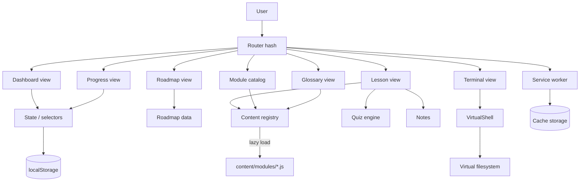

# TSD — LabSiber

| Field | Nilai |
| --- | --- |
| Produk | LabSiber |
| Versi dokumen | 0.1 (draft untuk PR #1) |
| Tanggal | 2026-11-07 |
| Status | Menunggu review |
| Dokumen terkait | [PRD](./PRD.md), [Stack](./STACK.md), [PR Plan](./PR_PLAN.md) |

---

## 1. Ringkasan arsitektur

LabSiber adalah **static single-page application tanpa build step**. Semua kode
dikirim apa adanya ke browser dan dijalankan dari GitHub Pages/CDN.

```text
┌─────────────────────────────────────────────────────────────┐
│ Browser                                                     │
│                                                             │
│  index.html ──► assets/css/style.css                        │
│       │                                                     │
│       ├──► content/roadmap.js        (dimuat saat boot)     │
│       ├──► content/module-index.js   (dimuat saat boot)     │
│       ├──► assets/js/terminal.js     (dimuat saat boot)     │
│       └──► assets/js/app.js          (router + view)        │
│                                                             │
│  app.js ──lazy load──► content/modules/*.js                 │
│       │                                                     │
│       ├──► localStorage  (progres, catatan, tema)           │
│       └──► service worker (cache offline)                   │
└─────────────────────────────────────────────────────────────┘
                              │
                              ▼
                    GitHub Pages (static CDN)
```

**Prinsip utama**

1. **Tanpa server** — tidak ada API, database, autentikasi, atau eksekusi perintah.
2. **Tanpa build** — file yang di-commit adalah file yang dijalankan.
3. **Konten sebagai data** — materi, kuis, dan misi disimpan dalam modul JS.
4. **Progres lokal** — localStorage; ekspor/impor untuk portabilitas.
5. **Aman secara default** — tidak ada `eval`, tidak ada inline script, konten di-escape.
6. **Path relatif** — kompatibel dengan GitHub Pages di subpath `/<repo>/`.

---

## 2. Diagram komponen



---

## 3. Struktur repository

```text
/
├── index.html
├── README.md
├── LICENSE
├── LICENSE-CONTENT
├── .nojekyll
├── .gitignore
├── .editorconfig
├── manifest.webmanifest
├── sw.js
├── assets/
│   ├── css/
│   │   └── style.css
│   ├── js/
│   │   ├── app.js
│   │   └── terminal.js
│   └── icons/
│       ├── favicon.svg
│       ├── icon-192.png
│       └── icon-512.png
├── content/
│   ├── roadmap.js
│   ├── module-index.js
│   └── modules/
│       ├── 01-fondasi.js
│       ├── 02-jaringan.js
│       ├── 03-os.js
│       ├── 04-kripto-identitas.js
│       ├── 05-serangan.js
│       ├── 06-blue-team.js
│       └── 07-cloud-prog-karier.js
├── docs/
│   ├── PRD.md
│   ├── TSD.md
│   ├── STACK.md
│   ├── PR_PLAN.md
│   └── adr/
├── scripts/
│   ├── validate.mjs
│   └── test-terminal.mjs
└── .github/
    ├── PULL_REQUEST_TEMPLATE.md
    ├── ISSUE_TEMPLATE/
    └── workflows/
        ├── validate.yml
        └── deploy.yml
```

---

## 4. Model data

### 4.1 Roadmap

`content/roadmap.js` menetapkan `window.CYBER_ROADMAP`.

```js
{
  source: "https://roadmap.sh/cyber-security",
  sections: [
    {
      id: "networking",
      title: "Networking Knowledge",
      short: "Jaringan",
      intro: "…",
      nodes: [
        {
          id: "osi-model",
          title: "OSI Model",
          desc: "…",
          module: "jaringan",   // opsional
          kind: "module"        // opsional: module | practice | reference | cert
        }
      ]
    }
  ]
}
```

**Aturan**

- `id` node unik secara global.
- `module` harus merujuk ke ID di `module-index.js` (divalidasi).
- Node tanpa `module` tetap tampil dan bisa ditandai manual.

### 4.2 Module index

`content/module-index.js` menetapkan `window.CYBER_MODULE_INDEX`.
Ini adalah metadata ringan untuk katalog dan lazy loading.

```js
{
  modules: [
    {
      id: "jaringan",
      file: "content/modules/02-jaringan.js",
      order: 3,
      title: "Jaringan & Model OSI",
      track: "Jaringan",
      level: "Pemula",
      duration: 50,
      summary: "…",
      status: "ready"        // ready | planned
    }
  ]
}
```

**Status modul**

- `ready`: file konten sudah ada, wajib lolos validator.
- `planned`: metadata sudah ada, file konten belum di-commit. Katalog dan roadmap
  menampilkan "konten segera hadir"; validator tidak mewajibkan konten.

Ini memungkinkan `main` tetap valid saat konten ditambahkan bertahap lewat PR.

### 4.3 Module content

`content/modules/*.js` menetapkan `window.CYBER_MODULES[id]`.

```js
{
  id: "jaringan",
  order: 3,
  title: "Jaringan & Model OSI",
  track: "Jaringan",
  level: "Pemula",
  duration: 50,
  summary: "…",
  objectives: ["…"],
  sections: [
    {
      title: "Model OSI",
      blocks: [
        "Paragraf dengan **bold**, `kode`, dan [link](https://example.com).",
        { sub: "Subjudul" },
        { list: ["…"] },
        { olist: ["…"] },
        { code: { lang: "bash", label: "terminal", code: "ip a" } },
        { table: { head: ["A", "B"], rows: [["1", "2"]] } },
        { note: "…" },
        { tip: "…" },
        { warn: "…" },
        { danger: "…" },
        { quote: "…" },
        { hr: true }
      ]
    }
  ],
  terms: [{ term: "…", def: "…" }],
  quiz: [{ q: "…", options: ["…"], answer: 0, explain: "…" }],
  terminal: {
    intro: "…",
    challenges: [
      {
        id: "jaringan-1",
        task: "…",
        hint: "…",
        pattern: "^ip (a|addr)$",
        solution: "ip a",
        explain: "…"
      }
    ]
  },
  lab: {
    title: "…",
    goal: "…",
    safety: "…",
    steps: [{ text: "…", code: "…" }],
    challenge: "…"
  },
  resources: [{ label: "…", url: "https://…" }]
}
```

**Aturan validasi**

- `id` modul unik dan sama dengan key `CYBER_MODULES`.
- `quiz[].options` tepat 4; `answer` 0–3; `explain` wajib.
- `terminal.challenges[].pattern` harus regex valid dan cocok dengan `solution`.
- `terminal.challenges[].id` unik di seluruh modul.
- `resources[].url` harus `https://`.
- Tidak boleh ada `TODO`, `lorem`, atau karakter CJK tak sengaja.
- Semua section punya minimal satu blok.

### 4.4 State pengguna

Key: `labsiber.v1`

```js
{
  version: 1,
  completedModules: ["fondasi"],
  quiz: {
    fondasi: { best: 5, total: 6, at: 1762500000000 }
  },
  terminal: {
    fondasi: ["fondasi-1", "fondasi-2"]
  },
  roadmap: ["popular-suites"],   // node manual tanpa modul
  notes: { fondasi: "catatan saya…" },
  bookmarks: ["jaringan"],
  history: [{ moduleId: "fondasi", at: 1762500000000 }],
  streak: { last: "2026-11-07", count: 3, best: 5, days: ["2026-11-05"] },
  theme: "dark",
  createdAt: 1762500000000,
  updatedAt: 1762500000000
}
```

**Aturan**

- Semua field opsional saat load; merge dengan default.
- `version` dipakai untuk migrasi.
- Jangan menyimpan data pribadi atau secret.
- `save()` menangani `QuotaExceededError` dengan toast.
- Ekspor: JSON dengan `version`, `exportedAt`, dan state.
- Impor: validasi bentuk; tawarkan replace, bukan merge diam-diam.

### 4.5 Selector progres

| Selector | Rumus |
| --- | --- |
| Modul selesai | `completedModules.length / 17` |
| Node selesai | node dengan modul selesai + node manual |
| Progres bagian | node selesai di bagian / total node bagian |
| Rata-rata kuis | rata-rata `quiz[id].best / total` untuk modul yang punya kuis |
| Misi terminal | jumlah ID unik di `terminal` |
| Streak | dihitung saat aplikasi dibuka |

Modul dianggap selesai jika pengguna menekan **Tandai selesai**. Kuis dan terminal
menambah statistik tetapi tidak otomatis menandai modul selesai. Ini mencegah
"selesai" palsu hanya karena membuka halaman.

---

## 5. Routing & rendering

### 5.1 Tabel route

| Hash | View | Data |
| --- | --- | --- |
| `#/` | Dashboard | state + roadmap + index |
| `#/roadmap` | Roadmap | roadmap + state |
| `#/modules` | Katalog modul | module index + state |
| `#/module/:id` | Lesson | module (lazy) + state |
| `#/terminal` | Terminal bebas | terminal.js |
| `#/glossary` | Glosarium | semua modul (lazy semua file) |
| `#/progress` | Progres | state + index |

Query opsional: `?q=`, `?track=`, `?status=`, `?filter=`.
Pencarian global adalah overlay, bukan route.

### 5.2 Pipeline render

```text
hashchange
  → parse route
  → pastikan dependency termuat (await ensureModule / ensureAll)
  → render HTML ke #view
  → pasang hook pasca-render:
       - TOC scrollspy
       - mount terminal
       - quiz handlers
       - notes autosave
       - copy buttons
  → update nav aktif, document.title, fokus ke #view, scroll top
```

**Aturan**

- Semua event memakai delegation pada `#view` bila memungkinkan.
- Hook yang membuat observer/listener harus dibersihkan saat route berubah.
- Jika modul tidak ditemukan, tampilkan halaman 404 yang ramah, bukan error mentah.
- Jika file konten gagal dimuat, tampilkan tombol "Coba lagi".

### 5.3 Lazy loading konten

`module-index.js` memetakan modul → file. App menyimpan `Map<file, Promise>`.

```js
function ensureFile(file) {
  if (!loadPromises.has(file)) {
    loadPromises.set(file, new Promise((resolve, reject) => {
      const s = document.createElement("script");
      s.src = file;
      s.async = true;
      s.onload = resolve;
      s.onerror = () => reject(new Error("Gagal memuat " + file));
      document.head.appendChild(s);
    }));
  }
  return loadPromises.get(file);
}

async function ensureModule(id) {
  const meta = moduleIndex.find((m) => m.id === id);
  if (!meta) return null;
  await ensureFile(meta.file);
  return window.CYBER_MODULES[id] || null;
}
```

**Catatan:** file modul berisi 2–4 modul. Setelah satu file dimuat, modul lain di
file yang sama langsung tersedia.

---

## 6. Renderer blok materi

### 6.1 Escaping

Semua teks dari konten di-escape terlebih dahulu:

```js
function esc(s) {
  return String(s).replace(/[&<>"']/g, (c) => ({
    "&": "&amp;", "<": "&lt;", ">": "&gt;",
    '"': "&quot;", "'": "&#39;"
  })[c]);
}
```

Setelah escape, barulah markup inline diterapkan (`**bold**`, `` `code` ``,
`[text](https://…)`). Ini mencegah HTML mentah dari konten.

### 6.2 Tipe blok

| Tipe | Output |
| --- | --- |
| `string` | `<p>` dengan inline markup |
| `{sub}` | `<h3>` |
| `{list}` | `<ul><li>` |
| `{olist}` | `<ol><li>` |
| `{code}` | code block + tombol salin |
| `{table}` | wrapper scroll + `<table>` |
| `{note}` / `{tip}` / `{warn}` / `{danger}` | callout dengan label |
| `{quote}` | blockquote |
| `{hr}` | `<hr>` |

### 6.3 Tombol salin

Kode disimpan di atribut `data-copy` dalam bentuk `encodeURIComponent`.
Klik → `navigator.clipboard.writeText(decodeURIComponent(...))`.
Fallback: textarea sementara + `document.execCommand("copy")`.

---

## 7. Mesin terminal

### 7.1 Komponen

```text
terminal.js
├── baseFS()        → peta path → file/dir + mode + owner
├── VirtualShell    → cwd, user, history, run()
│   ├── resolve/normalize path
│   ├── tokenize + pipe + redirection + sudo
│   ├── permission check
│   └── command dispatch
└── mount(container, options)
    ├── render UI
    ├── riwayat ↑/↓
    ├── reset
    └── validasi misi via regex
```

### 7.2 Kontrak

```js
const shell = new CyberTerminal.VirtualShell(fs);
const result = shell.run("sudo tail -n 20 /var/log/auth.log");
// result = { output: "...", clear?: true }
```

- `run()` tidak pernah melempar error untuk input pengguna; kesalahan menjadi teks.
- Output berupa teks polos; UI memakai `textContent`.
- Pipe didukung dengan menjalankan tiap segmen dan meneruskan stdout.
- Redireksi `>` dan `>>` didukung.
- `sudo` memberi hak root hanya untuk perintah tersebut.
- Permission dibaca dari mode/owner di FS virtual.

### 7.3 Misi terminal

- Setiap misi punya `pattern` (regex) yang diuji terhadap **perintah mentah**.
- Solusi disimpan untuk ditampilkan, bukan untuk dieksekusi.
- Setelah cocok, ID misi disimpan dan UI menandai selesai.
- Pola harus cocok dengan solusi (divalidasi di CI).

### 7.4 Keamanan terminal

- Tidak ada `eval`, `Function`, `fetch`, atau WebSocket.
- Tidak ada akses ke filesystem nyata atau proses sistem.
- Semua output dibuat dari data statis di `terminal.js`.
- Input tidak pernah dikirim ke server.
- UI menyatakan bahwa shell adalah simulasi.

---

## 8. Kuis

- Satu soal = satu `div` dengan tombol opsi.
- Klik opsi:
  1. tandai benar/salah,
  2. nonaktifkan opsi soal itu,
  3. tampilkan penjelasan,
  4. tambah skor.
- Setelah semua soal dijawab, simpan `best = max(best, skor)`.
- "Ulangi kuis" mereset tampilan tetapi tidak menghapus skor terbaik.
- Status a11y: feedback memakai `aria-live="polite"`.

---

## 9. Catatan & pencarian

### 9.1 Catatan

- `<textarea>` per modul.
- Autosave debounce 500 ms ke `state.notes[moduleId]`.
- Indikator "Tersimpan" / "Menyimpan…" dengan timestamp.
- Tidak ada sinkronisasi server.

### 9.2 Pencarian

- Sumber: module index (judul, ringkasan), roadmap nodes (judul, desc), terms.
- Normalisasi: lowercase, hapus diakritik sederhana.
- Skor: exact title > prefix > substring.
- Overlay Ctrl/Cmd+K, `/` saat bukan di input.
- Navigasi ↑/↓/Enter/Esc; fokus dikembalikan setelah tutup.

### 9.3 Glosarium

- Agregasi semua `terms` dari modul yang tersedia.
- Untuk glosarium, semua file modul dimuat (bisa di-cache).
- Dikelompokkan berdasarkan huruf awal; pencarian lokal.

---

## 10. Tema & responsif

- `data-theme="dark"` pada `<html>`; toggle menyimpan pilihan.
- Jika belum ada pilihan, gunakan preferensi `prefers-color-scheme`.
- CSS variables untuk warna, spacing, radius.
- Breakpoint: 1180px (grid), 900px (sidebar off-canvas), 640px (mobile).
- Sidebar off-canvas dengan scrim dan `aria-expanded`.
- `prefers-reduced-motion` menonaktifkan animasi.

---

## 11. PWA & offline

### 11.1 Manifest

```json
{
  "name": "LabSiber — Belajar Cyber Security dari Nol",
  "short_name": "LabSiber",
  "start_url": "./",
  "scope": "./",
  "display": "standalone",
  "background_color": "#070b12",
  "theme_color": "#070b12",
  "icons": [
    { "src": "assets/icons/icon-192.png", "sizes": "192x192", "type": "image/png" },
    { "src": "assets/icons/icon-512.png", "sizes": "512x512", "type": "image/png" }
  ]
}
```

### 11.2 Service worker

- `CACHE_NAME = "labsiber-v1"` (naikkan saat rilis).
- **Precache**: `index.html`, CSS, JS, roadmap, module-index, ikon, manifest.
- **Runtime cache**: file modul yang dibuka (stale-while-revalidate).
- **Navigation**: network-first, fallback ke cache `index.html`.
- **Activate**: hapus cache lama; `skipWaiting` + `clients.claim`.
- Jangan cache request non-GET atau cross-origin.

### 11.3 Pembaruan

- Versi cache dinaikkan manual setiap rilis.
- Pengguna menerima versi baru pada kunjungan berikutnya.
- Tidak ada prompt pembaruan di v1.0 (disederhanakan).

---

## 12. Keamanan

| Area | Keputusan |
| --- | --- |
| Content Security Policy | Meta tag: `default-src 'self'; script-src 'self'; style-src 'self' 'unsafe-inline'; img-src 'self' data:; connect-src 'self'; object-src 'none'; base-uri 'none'` |
| Inline script | Dilarang; registrasi service worker dipindah ke `app.js` |
| Inline event handler | Dilarang; gunakan event delegation |
| Konten | Escape sebelum render; link eksternal `rel="noopener noreferrer"` |
| Terminal | Simulasi murni; tanpa eval/network |
| localStorage | Hanya progres; tidak ada secret/PII |
| Dependency | Nol runtime dependency; tidak ada CDN |
| Supply chain | Konten dan kode di repo; review PR |
| GitHub Pages | HTTPS otomatis; header CSP tidak dapat diatur, meta CSP dipakai |

**Catatan:** `frame-ancestors` tidak berlaku di meta CSP. Jika clickjacking menjadi
perhatian, gunakan hosting yang mendukung header (Cloudflare Pages) atau terima
risiko karena situs tidak memuat data sensitif.

---

## 13. Aksesibilitas

- Landmark: `header`, `nav`, `main`, `aside`.
- Skip link ke `#view`.
- Fokus dipindah ke `#view` setelah navigasi route.
- Fokus terlihat (`:focus-visible`).
- Semua kontrol dapat diakses keyboard.
- Tombol ikon punya `aria-label`.
- Sidebar mobile memakai `aria-expanded` dan scrim.
- Toast memakai `role="status"` + `aria-live="polite"`.
- Terminal memakai `role="log"` dan label input.
- Kuis memberi feedback via teks, bukan hanya warna.
- Kontras teks minimal 4.5:1.
- Tidak ada animasi yang tidak dapat dimatikan.

---

## 14. Performa

| Keputusan | Alasan |
| --- | --- |
| Tanpa framework | Mengurangi JS runtime dan hidrasi |
| Konten lazy-load per file | Muat awal kecil |
| System font stack | Tidak ada request font eksternal |
| Ikon SVG inline | Tidak ada request gambar tambahan |
| Event delegation | Sedikit listener |
| Observer untuk TOC | Tidak ada scroll handler berat |
| Service worker | Kunjungan berikutnya cepat/offline |
| CSS variables | Tema tanpa duplikasi besar |

**Budget awal (gzip, tanpa konten modul)**

- HTML ≤ 8 KB
- CSS ≤ 18 KB
- JS app + terminal ≤ 60 KB
- Total ≤ 120 KB

**Budget modul**

- Satu file modul ≤ 40 KB (gzip ≤ 12 KB).
- Jika melebihi, pecah file.

---

## 15. Pengujian & validasi

### 15.1 `scripts/validate.mjs`

Menjalankan konten di `vm` dengan `window` palsu, lalu memeriksa:

- ID modul unik; metadata index cocok dengan modul.
- Semua `module` di roadmap ada di index.
- Node roadmap unik.
- Quiz: 4 opsi, `answer` valid, `explain` ada.
- Terminal: `pattern` valid dan cocok dengan `solution`.
- ID misi unik.
- Block types valid.
- URL resource `https://`.
- Deteksi placeholder (`TODO`, `lorem`, `FIXME`).
- Deteksi karakter CJK tak sengaja.
- Section tidak kosong.

Exit code non-zero jika ada error; dipakai di CI.

### 15.2 `scripts/test-terminal.mjs`

- Memuat `terminal.js` di `vm` dengan `window` palsu.
- Menguji perintah inti: `pwd`, `ls`, `cat`, `grep`, pipe, `sudo`, `chmod`, `find`, `nmap`, `dig`.
- Menguji permission `cat /etc/shadow` tanpa sudo (harus denied).
- Menguji setiap pola misi terhadap solusinya.

### 15.3 Pemeriksaan statis

- `node --check` untuk semua file JS.
- Tidak ada `console.log` yang tertinggal (kecuali debug terkontrol).
- Tidak ada secret (regex sederhana).

### 15.4 QA manual

| Area | Uji |
| --- | --- |
| Route | Semua hash route, refresh, back/forward |
| Modul | Semua modul terbuka, TOC, quiz, terminal, notes |
| Progress | Tandai selesai, quiz best, terminal, export/import/reset |
| Responsif | 360, 768, 1024, 1440 |
| Tema | Dark/light, persist |
| Keyboard | Tab, Enter, Esc, Ctrl+K, panah di search |
| Offline | Matikan network setelah load, buka modul yang sudah dimuat |
| Aksesibilitas | axe DevTools, kontras, fokus |
| Lighthouse | Performance, Accessibility, Best Practices, SEO |

---

## 16. Deployment & CI/CD

### 16.1 GitHub Pages

- Repo publik.
- Settings → Pages → Source: **GitHub Actions**.
- Workflow deploy mengunggah artifact dari root repo.
- `.nojekyll` disertakan.
- Semua path relatif agar bekerja di `/<repo>/`.
- Custom domain opsional.

### 16.2 Workflow

**`validate.yml`** — pada `pull_request` dan `push` ke `main`:

```yaml
- checkout
- setup-node 20
- node --check assets/js/app.js assets/js/terminal.js content/**/*.js
- node scripts/validate.mjs
- node scripts/test-terminal.mjs
```

**`deploy.yml`** — pada `push` ke `main`:

```yaml
permissions:
  contents: read
  pages: write
  id-token: write
concurrency:
  group: pages
  cancel-in-progress: true
steps:
  - checkout
  - configure-pages
  - upload-pages-artifact (path: .)
  - deploy-pages
environment: github-pages
```

### 16.3 Branch protection

- `main` hanya menerima PR.
- Status check `validate` wajib.
- Minimal 1 approval (PM).
- Linear history opsional.
- Force push dilarang.

---

## 17. Kompatibilitas browser

| Browser | Versi minimum | Catatan |
| --- | --- | --- |
| Chrome/Edge | 2 versi terakhir | Target utama |
| Firefox | 2 versi terakhir | Uji CSS `color-mix` |
| Safari iOS | 16+ | Uji `backdrop-filter`, `dvh` |
| Android Chrome | 2 versi terakhir | Uji 360px |

Fitur yang dipakai: ES2020, CSS variables, `color-mix()`, `backdrop-filter`,
`IntersectionObserver`, `localStorage`, `Service Worker`, Web Crypto (opsional).
Jika `color-mix` tidak didukung, sediakan fallback warna.

---

## 18. Observabilitas & privasi

- Tidak ada analytics, cookie pihak ketiga, atau beacon.
- Tidak ada data yang dikirim ke server.
- Untuk debugging, sediakan halaman/console flag lokal (opsional) yang tidak
  mengirim data.
- Progress hanya di localStorage; pengguna dapat menghapusnya kapan saja.

---

## 19. Risiko teknis & mitigasi

| Risiko | Mitigasi |
| --- | --- |
| Global namespace collision | Semua global berprefix `CYBER_`; modul memakai IIFE |
| Lazy load gagal | Tampilkan retry; cache promise; fallback pesan |
| Cache service worker basi | Naikkan `CACHE_NAME`; cleanup di activate |
| LocalStorage penuh | Tangkap error; sarankan ekspor; bersihkan data lama |
| Skema state berubah | `version` + fungsi migrasi |
| Konten besar | Lazy load; pecah file; validator ukuran |
| CSP memblokir inline style | `style-src 'unsafe-inline'` khusus style; tanpa inline script |
| GitHub Pages subpath | Semua URL relatif; uji di preview |
| Hash routing & SEO | Meta description; sitemap statis; pertimbangkan prerender nanti |
| Terminal disalahpahami | Disclaimer UI + dokumentasi batasan |

---

## 20. Status implementasi saat ini

| Area | Status | PR |
| --- | --- | --- |
| Dokumen produk/teknis | Ada (dokumen ini) | #1 |
| `index.html`, CSS | Ada di working tree | #2 |
| `app.js` | Belum ada | #2–#4, #11–#13 |
| `terminal.js` | Ada di working tree | #11 |
| `roadmap.js` | Ada di working tree | #3 |
| `module-index.js` | Belum ada | #3 |
| 17 modul konten | Ada di working tree | #4–#10 |
| `manifest`, `sw.js`, ikon | Belum ada | #13 |
| Validator & test | Belum ada | #3, #11 |
| CI & deploy | Belum ada | #3, #14 |
| README final & release notes | Sebagian | #1, #15 |

**Catatan:** working tree saat ini berisi prototipe yang belum di-commit. PR plan
memecahnya menjadi potongan yang dapat direview. Tidak ada kode yang dianggap final
sebelum lolos validator dan QA.

---

## 21. ADR

| ADR | Keputusan |
| --- | --- |
| [0001](./adr/0001-static-no-build.md) | Situs statis tanpa build step |
| [0002](./adr/0002-content-as-js-modules.md) | Konten sebagai modul JS + lazy load |
| [0003](./adr/0003-local-first-progress.md) | Progres lokal tanpa akun |
| [0004](./adr/0004-github-pages-hosting.md) | GitHub Pages sebagai hosting utama |
| [0005](./adr/0005-browser-terminal-simulator.md) | Terminal simulasi di browser |

---

## 22. Rencana implementasi

Urutan dan kriteria per PR ada di [PR_PLAN.md](./PR_PLAN.md).
Setiap PR wajib:

- [ ] Satu fokus.
- [ ] `node --check` lulus.
- [ ] Validator lulus.
- [ ] Tidak menambah runtime dependency.
- [ ] Tidak ada secret/PII.
- [ ] Uji manual dicatat.
- [ ] Screenshot untuk perubahan UI.
- [ ] Dokumen diperbarui bila relevan.
